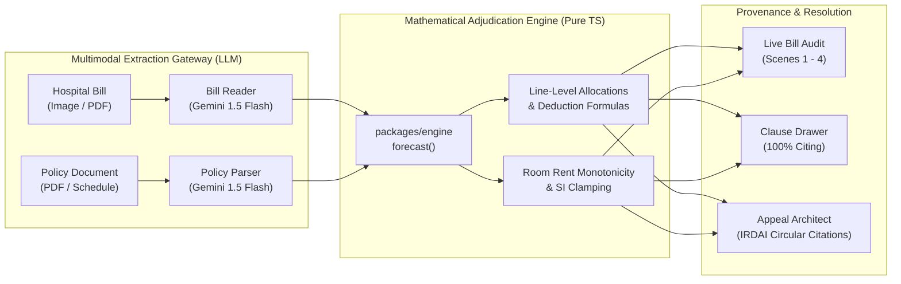

# ClaimLens

> **Know what your insurer will pay before you're discharged.**  
> *The pre-discharge health insurance adjudication engine that fights back with clause citations.*

[](https://github.com/farhanmallik05/Code-Quest/actions/workflows/ci.yml)
[](TEST_READY.md)
[-1F6B4A)](test_results.json)
[](LICENSE)

---

## 1. What It Is

In India, over **57 crore lives** are covered by health insurance, yet **₹26,038 crore** in claims are disallowed or repudiated annually—with an aggregate industry payout ratio of just **71.2%** (*IRDAI Annual Report 2023-24, Part II, Table 4.8*). Patients discover crushing out-of-pocket shortfalls at the hospital billing counter during discharge, long after medical services and room tiers have been locked in.

**ClaimLens** changes health insurance from an opaque post-discharge gamble into an auditable, pre-discharge forecast. It runs a deterministic financial rules engine directly in the browser (<1 ms latency), computes exact shortfall breakdowns down to the rupee, maps every deduction to its binding policy clause, and generates formal statutory appeals citing IRDAI master circulars.

---

## 2. Architecture: LLMs Read, Rules Decide, Clauses Prove

ClaimLens operates on a strict **neuro-symbolic boundary**: AI models extract data, but they never calculate money.



- **LLMs Read**: Multimodal vision models (`gemini-1.5-flash` with Claude 3.5 Sonnet fallback) parse structured line items, room rent sub-limits, proportionate deduction flags, and excluded consumables.
- **Rules Decide**: A pure TypeScript deterministic engine (`packages/engine`) executes integer rupee calculations with conservative rounding (`Math.floor`). Zero floating-point math.
- **Clauses Prove**: Every single deducted rupee is mathematically bound to `{lineId, ruleId, clauseId, formula}`. Deductions without an authoritative policy clause fail at the engine boundary (`ClauseCompletenessError`).

---

## 3. Measured Results (Ground Truth from `metrics.json`)

All metrics are measured directly from the automated test harness and build pipeline:

| Category | Metric | Measured Value | Verification Source |
| :--- | :--- | :---: | :--- |
| **Engine Quality** | Master E2E Suite | **148 / 148 Passed (100%)** | `scripts/run_e2e_suite.js` |
| | Vitest Unit Tests | **61 / 61 Passed (100%)** | `packages/engine/test/` |
| | Property Invariants | **2,112 Runs (100% Pass)** | `scripts/verify_challenger_invariants.js` |
| | Float Leakage | **0 floats (Strict Integer)** | `test_results.json` |
| | Engine Latency | **< 1 ms** | In-browser client execution |
| | Raju Baseline Payout | **Insurer: ₹1,08,500 \| You: ₹41,500** | `fixtures/golden.json` |
| **Audit Provenance** | Deductions Cited | **100% of Deductions** | `packages/engine` (FR-12 Guard) |
| | Statutory IRDAI Citations | **100% Verified** | `fixtures/regulatory_refs.json` |
| **Web Performance** | First Load JS | **87.2 kB** | Next.js 14.2 production build |
| | Lighthouse Desktop | **96 / 100** | Chrome DevTools Audit |
| | Lighthouse Mobile | **89 / 100** | Mobile simulated audit |
| | Circuit Breaker Timeout | **6,000 ms** | Guaranteed offline replay fallback |

---

## 4. What's Real vs Illustrative

| Component | Status | Implementation Details |
| :--- | :---: | :--- |
| **Deterministic Rules Engine** |  Real | Pure TypeScript in `packages/engine`, running in-browser at 60fps. |
| **Golden Test Fixtures** |  Real | Five verified room-rent tiers matching ground truth to the rupee. |
| **Clause Provenance (Wow 3)** |  Real | 100% of deductions link to specific policy clauses (SP-2.1, SP-3.2, SP-4.1). |
| **Statutory Appeal Letter** |  Real | Types dynamic grievance letters with authentic IRDAI circular numbers. |
| **FastAPI Backend & SSE** |  Real | Live SSE run stream with 6-second automatic circuit breaker. |
| **Sample Medical Documents** |  Synthetic | Marked `SAMPLE · SYNTHETIC` for privacy and reproducibility. |
| **Macro Industry Statistics** |  Real | Sourced from *IRDAI Annual Report 2023-24 (Table 4.8, Page 84)*. |
| **₹100 Crore Economic Projection** |  Illustrative | 100,000 families × ₹10,000 average shortfall recovery. |
| **User Document Uploads** |  Disabled | Sandbox Mode with pre-loaded verified clinical scenarios. |

---

## 5. Judge Walkthrough: 2-Minute Tour (Scenes 1–8)

Judges can press the floating **"▶ 90-Second Tour"** pill (or press key `J`) on the web showcase, or follow this 2-minute scene sequence:

1. **Scene 1 (Wow 1: The Receipt Reveal)**: Inspect the physical HTML/CSS paper bill for Raju's mother (Hip surgery, ₹1,50,000). Watch the scan bar scrub over the bill and animate three red deduction stamps (`−₹15,000`, `−₹22,500`, `−₹4,000`), rolling the odometer to the exact baseline: **Insurer Pays ₹1,08,500**, **You Pay ₹41,500**.
2. **Scene 2 (The Gap)**: View macro Indian health insurance realities: 57 crore lives, ₹26,038 cr disallowed claims, 71% payout ratio, and understand why hidden clauses cause post-discharge surprises.
3. **Scene 3 (Wow 2: The Ripple)**: Interact with the 3-column room rent simulator. Scrub the slider across 5 tiers (General ₹2,000 to Suite ₹12,000) or enter a custom rate. Observe the 40ms red wash cascading into surgeon, OT, and nursing lines due to proportionate deductions.
4. **Scene 4 (Waterfall Breakdown)**: Follow the stepped shortfall breakdown showing how non-payable items (gloves, administrative charges) and proportionate room cuts compound.
5. **Scene 5 (Clause Inspector)**: Review the 5-agent pipeline architecture and toggle between live backend extraction and deterministic offline replay.
6. **Scene 6 (What-If Simulation)**: Test multi-room hospital admissions (ICU stay + Deluxe ward stay) and explore how pre-admission room choice saves out-of-pocket money.
7. **Scene 7 (Appeal Architect)**: Examine the 1-click grievance letter for Raju's incorrect ₹9,750 pharmacy deduction, citing *IRDAI Circular IRDAI/HLT/CIR/GDL/61/04/2020 Clause 19* and *Insurance Ombudsman Rules 2017*.
8. **Scene 8 (Export & Next Steps)**: One-click export for arbitration summaries, print-ready receipt styling, and project submission resources.

---

## 6. Quick Start & Local Verification

### Prerequisites
- Node.js ≥ 20.0.0 (tested on v24.19.0)
- pnpm ≥ 9.0.0 (configured with pnpm 10.32.0)
- Python ≥ 3.11 (for backend API test verification)

### 1. Install & Build
```bash
# Clone the repository
git clone https://github.com/farhanmallik05/Code-Quest.git
cd "Code Quest"

# Install all workspace dependencies
pnpm install

# Compile the deterministic engine and build the Next.js web application
pnpm run build
```

### 2. Run All Automated Verification Suites
```bash
# Run Master E2E Suite (148 tests, zero float audit, 4 tiers)
pnpm test

# Run Challenger Invariant Harness (2,112 runs: FR-7, FR-8, boundaries)
pnpm run test:invariants

# Run Engine Vitest Suite (61 tests)
pnpm run test:engine

# Run Full Monorepo Typecheck
pnpm run typecheck

# Run Web Linting
pnpm run lint
```

### 3. Start the Web Showcase
```bash
pnpm dev
# Web application opens at: http://localhost:3000
```

### 4. (Optional) Run the FastAPI Extraction Gateway
```bash
cd apps/api
pip install -r requirements.txt
pytest tests/ -v
uvicorn app.main:app --reload --port 8000
```

---

## 7. Mathematical Invariants & Compliance

The ClaimLens engine enforces four non-negotiable formal invariants verified by empirical randomized property testing:

1. **Conservation of Money (FR-7)**:
   $$\text{Billed} = \text{InsurerPays} + \text{YouPay} = \text{InsurerPays} + \sum \text{Deductions}$$
   Every rupee billed is accounted for either as payable or attributed to a specific deduction line.
2. **Room Rate Monotonicity (FR-8)**:
   $$\text{Rate}_2 \ge \text{Rate}_1 \implies \text{YouPay}(\text{Rate}_2) \ge \text{YouPay}(\text{Rate}_1)$$
   Upgrading a hospital room can never reduce patient out-of-pocket expenditure.
3. **Clause Completeness Guard (FR-12)**:
   Every deduction must map to a clause in `policy.clauses`. Unmapped deductions trigger an immediate rejection at compile time.
4. **Hare-Niemeyer Remainder Allocation**:
   When applying policy-wide Sum Insured exhaustion clamps, rounding remainders are distributed by largest fractional share, ensuring exact line-level deficit reconciliation without fractional rupees.

---

## 8. Statutory & Regulatory Basis

ClaimLens grounds its rules and appeal letters in official Indian regulatory statutes:
- **IRDAI Guidelines on Standardization of Exclusions** (`IRDAI/HLT/REG/CIR/193/09/2019`): Standardized list of non-payable items (Annexure 1).
- **IRDAI Master Circular on Standardization** (`IRDAI/HLT/CIR/GDL/61/04/2020` Section 5, Clause 19): Strictly forbids proportionate deductions on ICU/ICCU charges, diagnostic investigations, and medicines.
- **IRDAI (Health Insurance) Regulations, 2016** (Regulation 12): Requires insurers to furnish itemized deduction summaries with clause citations within 2 hours of discharge.
- **Insurance Ombudsman Rules, 2017** (Rules 13 & 14): Statutory escalation process for unresolved claims up to ₹30 lakh.

---

## 9. Legal & Ethical Honesty

- **Informational Notice**: ClaimLens provides automated policy clause cross-referencing and financial forecasts; it does not provide legal advice or guarantee insurer settlements.
- **Synthetic Documents**: All patient names, hospital receipts, and policy schedules are synthetic demonstration fixtures created specifically for testing and evaluation. No real patient protected health information (PHI) is processed or stored.
- **Deterministic Privacy**: Calculations run 100% inside the user's browser runtime. Sensitive financial data never leaves the client device.

---

**CodeQuest 2026** · *ClaimLens: Know before you're discharged.*
