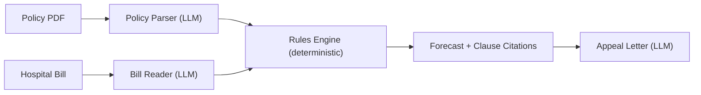

# ClaimLens — Content

> *Every word that appears on the page, in the video, in the README, and in the deck update.*

---

## 10.1 Copy deck

| Location | Copy |
| :--- | :--- |
| **Hero line** | **You were insured. You still owe ₹41,500.** |
| Hero sub | ClaimLens forecasts your payout before discharge, and shows the clause behind every rupee. |
| Scene 2 title | Insured, yet still left with the bill |
| Scene 2 stat 1 | `57 crore` lives covered by health insurance in FY24 |
| Scene 2 stat 2 | `₹26,038 cr` of claims disallowed or repudiated in FY24 |
| Scene 2 stat 3 | `71%` of claimed value was actually paid out |
| Scene 2 source | Source: IRDAI Annual Report 2023-24, as reported by PTI and Business Standard |
| Why cards title | Why it keeps happening |
| Why card 1 | Dense wordings hide room-rent caps, co-pay and sub-limits. |
| Why card 2 | Shortfalls surface at final settlement, after the bill is incurred. |
| Why card 3 | Appealing means insurer grievance cells, then the Ombudsman. |
| Raju card | Meet Raju (example). His mother needs hip surgery; a room upgrade leaves her ₹41,500 short. |
| Scene 3 title | Move the room. Watch the bill move. |
| Scene 3 onboarding hint | Your turn: drag the room rate. |
| Scene 4 title | Every rupee has a receipt |
| Scene 4 sub | Tap a deduction. See the clause and the arithmetic. |
| Scene 5 title | LLMs read, rules decide, clauses prove |
| Scene 6 title | Forecast-first, auditable, appeal-ready |
| Scene 6 footnote | Our assessment of expected typical offerings; capabilities vary by provider. |
| Scene 7 title | Fewer surprise bills, stronger appeals |
| Scene 8 title | Know before you're discharged. |
| CTA 1 | Run your own bill |
| CTA 2 | Watch the 2-minute video |
| CTA 3 | View the repo |
| CTA 4 | View the deck |
| Footer line 1 | Cites sources, not legal advice. |
| Footer line 2 | Illustrative · synthetic documents. |
| Impact figure | 1 lakh families × ₹10,000 = ₹100 crore *(illustrative)* |
| Agent zone labels | LLMs read · Rules decide · Clauses prove |

---

## 10.2 Synthetic policy document (`public/policy-demo.pdf`)

Render a 2-page PDF (or high-fidelity HTML-to-print) from the clause table in trd.md §6.5.

**Page 1 layout:**
- Header: `Demo Assure — SafeCare Plus (Demo)` in a formal serif font
- **Schedule box** (top right):
  - Insured Name: `[Policyholder]`
  - Sum Insured: `₹5,00,000`
  - Policy Year: `01-Nov-2026 to 31-Oct-2027`
- Clauses SP-2.1 through SP-3.3 as numbered sections

**Page 2 layout:**
- Clauses SP-4.1 and SP-5.1
- Annexure A: *Non-Payable Items* — a bulleted list including "disposable gloves", "administrative and registration charges"
- Footer: `Demo Assure · This is a sample document`

**Mandatory diagonal watermark (both pages):** `SAMPLE · SYNTHETIC` in 72pt, 30% opacity, red.

---

## 10.3 Appeal letter (Finisher B)

```
To: The Grievance Redressal Officer, Demo Assure
Subject: Request to review claim settlement — Claim Ref CLM-DEMO-001

Dear Sir/Madam,

I am writing on behalf of the policyholder regarding the settlement of the above claim
under the policy "SafeCare Plus (Demo)".

On review, the settlement advice appears to differ from the policy terms in the following respect:

1. A proportionate reduction of ₹9,750 was applied to pharmacy and medicines
   (₹26,000 payable amount reduced to ₹16,250). Clause SP-3.3 [1] states that
   the proportionate deduction in clause SP-3.2 does not apply to pharmacy,
   medicines and diagnostic investigations.

Request: Please review this deduction and reinstate ₹9,750, or explain the basis
if you consider the clause inapplicable.

Enclosures:
- Policy schedule and clauses SP-3.2 and SP-3.3
- Hospital bill
- Settlement advice

If this cannot be resolved at your level, we understand the next step is the
Insurance Ombudsman.

Thank you for your attention.

Sincerely,
[Policyholder name]

Prepared with ClaimLens. Informational, not legal advice.

─────────────────────────────
Citations:
[1] Policy clause SP-3.3, page 1 — "Clause 3.2 does not apply to pharmacy,
    medicines and diagnostic investigations."
```

---

## 10.4 README skeleton

```markdown
# ClaimLens

> Know what your insurer will pay before you're discharged.

[Live demo →](https://claimlens.vercel.app) · [2-minute video →](#) · [Deck →](#)

---

## What it is

One-paragraph description of the product and the problem it solves.

[Insert hero GIF — recorded from the actual page]

---

## How it works



LLMs read. Rules decide. Clauses prove.

---

## What's real vs illustrative

| Component | Status |
|---|---|
| `forecast()` TypeScript engine | ✅ Real — runs in-browser, <1 ms |
| Golden fixtures | ✅ N/N tiers match to the rupee |
| Clause citations in Wow 3 | ✅ Enforced by CI (build fails without them) |
| Live-read pipeline (LangGraph) | [✅ Real / ⚠️ Replay-only — fill in] |
| Sample documents | ⚠️ Synthetic — marked SAMPLE · SYNTHETIC |
| ₹100 crore impact estimate | ⚠️ Illustrative |
| Supabase, pgvector | 🗓️ Roadmap |

---

## Measured results

[Fill from metrics.json after Sat polish pass]
- Engine: N/N golden fixtures match to the rupee; property tests (invariant, monotonic) pass
- Lighthouse: desktop XXX / mobile XXX; LCP X.Xs
- Live-read: median Xs on sample documents [or: replay-only]
- Extraction accuracy: X/X fields matched on golden set [or: not applicable]

---

## Run locally

```bash
pnpm install
pnpm dev        # web at :3000
# API (optional):
cd apps/api && pip install -r requirements.txt
uvicorn app.main:app --reload   # :8000
```

---

## Architecture and decisions

See [docs/plan/trd.md](docs/plan/trd.md) and [docs/plan/adrs.md](docs/plan/adrs.md).

---

## Limits and honesty

- All demo documents are synthetic. No real patient data is stored or processed.
- This tool cites sources; it does not provide legal advice.
- Uploads are disabled; the demo uses pre-defined sample documents.
- Live-read results are labelled Live or Replayed from a recorded run.

---

## Roadmap

- Native mobile app · Voice input · Direct TPA/hospital ERP integration
- Full Hindi UI · pgvector/RAG for multi-policy search
- Supabase Auth for personal policy storage
```

---

## 10.5 Video script (≤2 min)

| Time | Visual | Voiceover |
| :--- | :--- | :--- |
| 0:00–0:15 | Hero stamps land — `₹41,500` rolls up | *"Raju's mother was insured. She still owes ₹41,500. He found out at discharge."* |
| 0:15–0:30 | Scene 2 stats count up | *"This is not rare: lakhs of crores in claims are disallowed every year in India."* |
| 0:30–1:00 | Wow 2 — drag slider from Single AC to Deluxe | *"ClaimLens runs the policy's rules on the bill — before discharge. Watch what a room upgrade does to every line."* |
| 1:00–1:20 | Wow 3 — tap a deduction, clause drawer opens | *"Every rupee links to the clause and the arithmetic. No black boxes. The CI fails if any deduction is uncited."* |
| 1:20–1:40 | Live read — 5 agents light up in sequence | *"AI reads the documents. A deterministic engine does the math. Verified against ground truth."* |
| 1:40–1:55 | Appeal letter types itself | *"And when the insurer is wrong, ClaimLens drafts the cited appeal — and tells you which tier to escalate to."* |
| 1:55–2:00 | Footer strip | *"ClaimLens. Know before you're discharged."* |

---

## 10.6 Deck updates required before submission

| Slide | Change needed |
| :--- | :--- |
| Slide 1 | Add QR code and short URL to the live Vercel page |
| Slide 2 | Add footnote hyperlinks to the IRDAI Annual Report 2023-24 source |
| Slide 5 | Mark pgvector, Auth as "Roadmap (not in demo)" |
| Slide 6 | Replace the 2–15 Nov sprint view with the 5-day plan and "what's built" status |
| Slide 7 | Replace "±10% forecast error" with measured values from `metrics.json`, or remove |
| Last slide | Add QR code and short URL |

