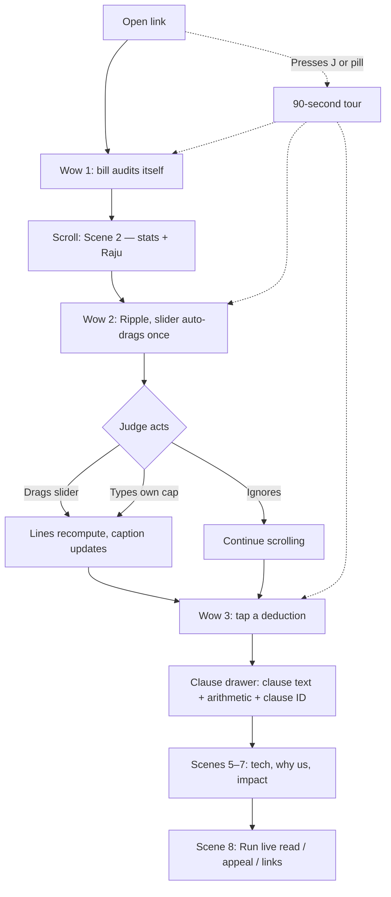
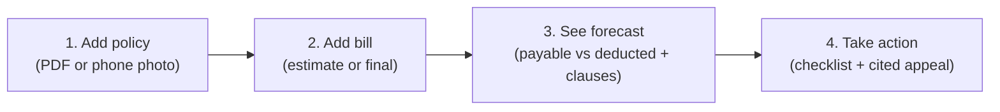
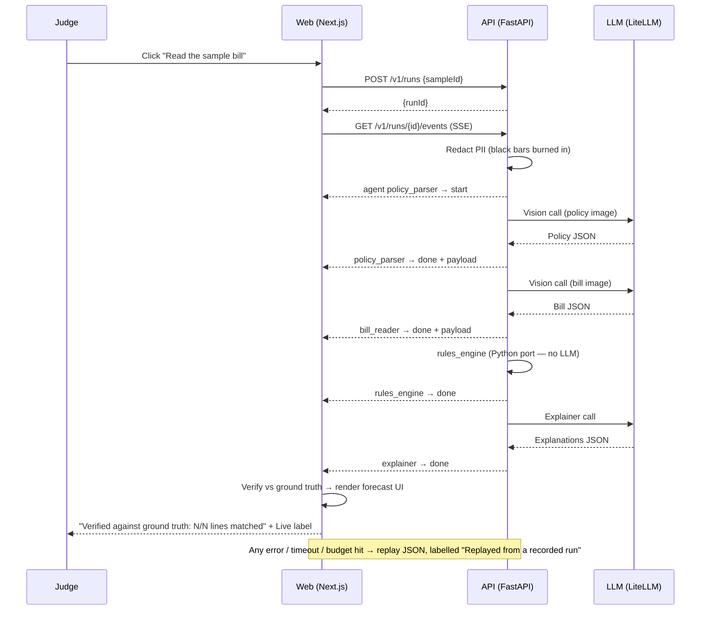

# ClaimLens — User Flows

---

## 4.1 Judge flow (primary path)

---

## 4.2 Product flow (the deck's 4-step promise)

---

## 4.3 Live read flow — Finisher A

---

## 4.4 Error and edge paths

| Situation | Behaviour |
| :--- | :--- |
| API cold start / timeout >6 s | Switch to **Replayed from a recorded run** automatically; label shown prominently |
| LLM returns invalid JSON | One retry with repair prompt; if still invalid → replay |
| Extraction ≠ ground truth on sample | Show diff honestly (`"12/14 lines matched"`) and still render the forecast |
| Rate limit hit | Replay + message `"Live budget reached"` |
| JS disabled | `<noscript>` static receipt showing the ₹41,500 result |
| `prefers-reduced-motion` | Static scenes; slider still interactive |
| API unavailable entirely | Page works fully from replay; engine runs in-browser |

